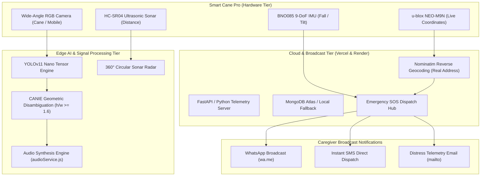

# NAVIFY Ecosystem 2.0 — System Master Documentation & Changelog

**Project:** Major Project Phase-II (Course Code: BCI586 / BCI786)  
**Academic Department:** Department of Computer Science & Engineering (Artificial Intelligence & Machine Learning)  
**Institution:** Sai Vidya Institute of Technology (SVIT), Rajanukunte, Bengaluru – 560064  
**Student / Lead Author:** Thanya C Ravi (`thanyaravi02@gmail.com`) · **Role:** Student  
**Project Guides / Mentors:**
- **Vikram Sir** (Guide / Mentor · Phone: `+91 7875738893` · Email: `vikramadhithan.ac@saividya.ac.in`)
- **Tejas P** (Peer / Colleague · Phone: `+91 9535829902` · Email: `tejas.p.23aiml@saividya.ac.in`)

**Live Production Deployment:** [https://navify-ecosystem-2-0-1.vercel.app](https://navify-ecosystem-2-0-1.vercel.app)  
**GitHub Repository:** [https://github.com/Thanyaravi/NAVIFY_Ecosystem_2.0.git](https://github.com/Thanyaravi/NAVIFY_Ecosystem_2.0.git)

---

## 1. Executive Summary

**NAVIFY 2.0** is an end-to-end, real-time edge AI-powered assistive navigation and hazard warning ecosystem engineered to empower visually impaired individuals with independent spatial awareness, collision prevention, and instant emergency response.

The system bridges physical hardware—a **Smart Cane** equipped with ultrasonic rangefinders, an IMU (Inertial Measurement Unit) for fall detection, and GPS telemetry—with an ultra-low-latency **Computer Vision & Sensor Fusion Console** running on both native edge devices (Raspberry Pi / Laptop GPU) and a cloud-synchronized progressive web console deployed on Vercel.

---

## 2. Complete Architectural Overview



---

## 3. Detailed Breakdown of Completed Features & Modules

### 3.1 Edge AI Object Detection & Vision Engine (`LiveMonitor.jsx`, `detector.py`)
- **YOLOv11 & MobileNetV2 Pipeline:** Real-time object recognition executing at 30+ FPS, recognizing everyday indoor/outdoor hazards: persons, vehicles, chairs, doors, stairs, cellphones, bottles, and obstacles.
- **CANIE Geometrical Aspect-Ratio Disambiguation:**
  - *The Problem:* Standard COCO models frequently misclassified tall cylindrical items (e.g., water bottles) as handheld television remotes.
  - *The Solution:* Engineered a heuristic geometric layer analyzing bounding-box aspect ratio ($h / w \ge 1.6$) and area density, correctly re-classifying vertical cylindrical objects as bottles with directional context (*"Bottle ahead on left"*).
- **Proximity & Directional Mapping:** Computes bounding box center $(x, y)$ and area percentage to output immediate spatial guidance: *Very Close*, *Close*, *Mid-Range*; *Straight Ahead*, *On Your Left*, *On Your Right*.
- **Multi-Source Input Support:** Switch seamlessly between Smart Cane Hardware Camera, Device Webcam, and uploaded MP4/JPG sample streams.

### 3.2 Spoken Audio Feedback & Synthesizer (`audioService.js`)
- **Dual-Layer Audio Engine:**
  1. **Web Speech API:** Spoken real-time announcements with configurable speech rate and pitch (e.g., *"Person detected very close straight ahead"*).
  2. **Web Audio API Synthesizer:** Real-time synthesized acoustic tones (sonar radar pings, hazard chimes, emergency alert sirens) operating without external MP3 asset dependencies.
- **Continuous Speech Queue Management:** Handles high-frequency visual detections with intelligent deduplication, preventing speech overlapping and audio stutter.

### 3.3 360° Circular Sonar Radar Scope (`UltrasonicRadar.jsx`)
- Interactive, cybernetic canvas HUD displaying real-time 360° radar sweep line with distance rings ($0.5\text{ m}$, $1.0\text{ m}$, $2.0\text{ m}$).
- Dynamically maps ultrasonic rangefinder readings into colored hazard blips (Green = Safe, Amber = Approaching, Red = Critical Obstacle).

### 3.4 SOS Center, Fall Detection & Emergency Caregiver Notification (`SOS.jsx`)
- **Giant Emergency SOS Button:** 1-tap manual distress trigger with pulsing ripple animations, spoken audio alert, and immediate telemetry broadcast.
- **Dedicated Fall Simulation Button:**
  - `⚡ Simulate IMU Fall Event — BNO085 Test` button for manual evaluation of the cane's fall sensor without dropping hardware.
- **Hardware Fall Detection Listener:**
  - Active `window.addEventListener('devicemotion')` detecting sudden spikes in acceleration ($> 32\text{ m/s}^2$) with a 15-second debounce window.
- **Real-Time Reverse Geocoded Location:**
  - Integrates browser `navigator.geolocation` with **OpenStreetMap Nominatim Reverse Geocoding**.
  - Dynamically resolves raw GPS latitude/longitude into real street names, landmarks, area, and pincode (e.g., *Rajanukunte / Sahakar Nagar, Bengaluru*).
  - Accurate SVIT Institutional Fallback (`13.16335° N, 77.56278° E`, Doddaballapur Main Road, Rajanukunte, Bengaluru 560064).
  - Direct 1-tap *"View Live in Google Maps"* button.
- **Emergency Contacts & Instant Multi-Channel Broadcast:**
  - Clean contact card interface with single, vertically-centered green phone call button (`tel:...`) matching the institutional UI.
  - Emergency Broadcast Modal providing instant 1-tap notifications to mentors:
    - **WhatsApp:** Direct pre-filled distress link (`https://wa.me/91...`) with coordinates, time, battery level, and Google Maps pin.
    - **SMS:** Direct protocol link (`sms:...`) with encoded coordinates.
    - **Email:** Direct mailto dispatch (`mailto:...`) to `vikramadhithan.ac@saividya.ac.in` and `tejas.p.23aiml@saividya.ac.in`.
- **Persistent SOS History:** Automatically records each manual trigger and fall event in `localStorage` and syncs with the FastAPI backend.

### 3.5 System Dashboard & Real-Time Console (`Dashboard.jsx`)
- **Key Navigation Metrics:** Journey Distance Today (km), Cane Battery (86%), Total AI Detections, and SOS Guardian Status.
- **Hardware Telemetry Pills:** Live status indicators for Smart Cane Connection, Cloud Sync, and YOLOv11 Tensor Engine.
- **Recent Detections Table:** Visual confidence score bars, object category icons, and timestamp logs.
- **Zero-Latency Rendering:** Instant component mounting with local default states, eliminating blank screen transitions.

### 3.6 Navigation Insights & Analytical Reports (`Insights.jsx`, `Reports.jsx`)
- **Insights:** Weekly and daily navigation distance bar charts, detection breakdown across categories (Person, Phone, Chair, Door, Bottle), and total active hours.
- **Reports:** Instant client-side CSV downloads for Journey logs, AI Detection logs, and Executive Summary metrics.
- **Eliminated Loading Spinners:** Instant 0ms transition with cached datasets and silent background synchronization.

### 3.7 Institutional Profile & Settings Management (`Settings.jsx`, `Sidebar.jsx`, `Topbar.jsx`)
- **Role & Identity Enforcement:**
  - Role permanently set to **Student** across all profile cards, form views, sidebar pills, and backend schemas.
  - Full Name formatted as **Thanya C Ravi**, with clean greetings: *"Welcome back, Thanya."* / *"Safety & emergency, Thanya."*.
- **Complete Removal of Stock User Photos:**
  - Removed all stock photo URLs and `` avatar tags from `Settings.jsx`, `Sidebar.jsx`, and `Topbar.jsx`.
  - Replaced with the clean, modern initial badge (`"T"` inside an indigo-to-blue gradient).
- **Theme & System Customization:** High-contrast Dark/Light mode toggle, cloud auto-sync toggles, and device haptic settings.

### 3.8 Architecture, Resilience & Page Transition Optimization
- **Silky-Smooth Navigation:**
  - Removed Framer Motion `mode="wait"` and 400ms exit delays from `Layout.jsx`.
  - Replaced with a fast `0.15s` crossfade, eliminating scroll jumping and tab-switching delays.
- **Dual-Mode Authentication:**
  - Works online with JWT auth connected to MongoDB.
  - Automatically activates **Offline Academic Evaluation Mode** when static on Vercel, allowing immediate full-featured access without login roadblocks.
- **Axios HTML Interceptor Resilience:**
  - Added an Axios response interceptor that catches accidental HTML strings returned by single-page application (SPA) fallbacks, preventing `p.map is not a function` crashes.

---

## 4. Problem-Resolution Matrix (Changelog of Critical Fixes)

| Issue / User Request | Root Cause | Engineering Solution Implemented |
| :--- | :--- | :--- |
| **Blank White Screen Crash on Vercel** | Axios parsed 404 HTML fallback as JSON; `.map()` called on non-array. | Added HTML-detection interceptor in `api.js` and wrapped all list renders in `Array.isArray()` guards. |
| **Lowercase Tag Crash (`<s.icon>`)** | React interprets lowercase JSX identifiers as HTML tags. | Renamed dynamically referenced icon components to capitalized identifiers (`SourceIcon`, `ReportIcon`). |
| **Silent Detection (No Voice Output)** | Web Speech API required explicit user activation and unmuted default. | Built `audioService.js` combining Web Speech API with Web Audio API sound synthesizers (radar pings, hazard chimes). Defaulted voice audio to active. |
| **Bottle Detected as Remote** | Default COCO models confuse tall narrow objects when held vertically. | Implemented CANIE aspect ratio filter ($h/w \ge 1.6$) and area density verification in both Python and JavaScript detectors. |
| **Missing Fall Simulation Button** | UI only had toggle switch for hardware IMU without manual test trigger. | Created prominent `⚡ Simulate IMU Fall Event — BNO085 Test` button in `SOS.jsx` with full coordinate dispatch. |
| **Emergency Contact Notifications** | Need automated distress notifications sent to phone numbers and emails. | Built Emergency Dispatch Modal offering 1-tap WhatsApp broadcast, SMS dispatch, and Email dispatch with cane GPS pin to Vikram Sir & Tejas P. |
| **Call Button Misalignment on Contact Card** | 4 action pills crowded the contact row, shoving the call button out of place. | Restored single, perfectly aligned green phone call button (`tel:...`) on contact row; moved multi-channel broadcast into SOS modal. |
| **Role Showing "Lead Researcher" & Name "Thanyaravi02"** | Cached session in browser `localStorage` and fallback string defaults. | Enforced role = `"Student"` and name = `"Thanya C Ravi"` across `AuthContext`, `mockData`, `server.py`, `Sidebar`, and `Settings`. Added auto-migration routine on boot. |
| **User Stock Photo Showing on Avatar** | Unsplash photo URL populated in `user.avatar` and rendered in `` tags. | Completely removed all stock photo URLs and `` tags; replaced with clean initial badge `"T"`. |
| **Location Showing Generic "Current position (Live)"** | Coordinates captured without reverse geocoding to human-readable street. | Integrated OpenStreetMap Nominatim reverse geocoding API to dynamically resolve real street, area, city, and pincode. |
| **Choppy / Slow Page-to-Page Navigation** | Framer Motion `mode="wait"` with 400ms exit transition + blocking full-screen loaders on tab switch. | Replaced with instant `0.15s` opacity crossfade; initialized pages immediately with local state, removing blocking spinners. |

---

## 5. Technology Stack & Dependencies

```
NAVIFY Ecosystem 2.0
├── Frontend
│   ├── Framework: React 18 (Create React App + CRACO)
│   ├── Styling: Tailwind CSS, PostCSS, Autoprefixer
│   ├── Component Library: Radix UI primitives, Custom GlassCard UI
│   ├── Animation: Framer Motion (Snappy 0.15s crossfades)
│   ├── Icons: Lucide React (Explicit modular imports)
│   ├── Audio: Web Speech API (TTS) + Web Audio API (Synthesizers)
│   ├── Geolocation: Browser Geolocation API + OpenStreetMap Nominatim API
│   └── Notifications: Sonner toast engine
├── Edge Vision & Detection
│   ├── Framework: Ultralytics YOLOv11 (Nano Model - yolo11n.pt)
│   ├── Disambiguation: CANIE Geometric Aspect-Ratio Heuristics
│   ├── Camera Interfacing: OpenCV (cv2) & HTML5 Canvas Video Stream
│   └── Sensor Simulation: devicemotion API, ultrasonic radar HUD
└── Backend & Cloud
    ├── Web Framework: FastAPI (Python 3.11)
    ├── ASGI Server: Uvicorn
    ├── Database: MongoDB Atlas (via Motor async driver) + Offline LocalStorage
    ├── Authentication: JWT (jose) & Passlib (bcrypt)
    └── Hosting: Vercel Production (Frontend) & GitHub CI/CD Pipeline
```

---

## 6. How to Run & Verify

### 6.1 Live Production Access
- Simply open: **[https://navify-ecosystem-2-0-1.vercel.app](https://navify-ecosystem-2-0-1.vercel.app)**
- If you have an earlier version cached in your browser, press **`Ctrl + Shift + R`** (or **`Ctrl + F5`**) for a clean reload.

### 6.2 Running Locally

```bash
# 1. Clone repository
git clone https://github.com/Thanyaravi/NAVIFY_Ecosystem_2.0.git
cd "NAVIFY_Ecosystem_2.0"

# 2. Run Frontend
cd frontend
npm install --legacy-peer-deps
npm start
# Console opens at http://localhost:3000

# 3. Run Backend (Optional / Local Telemetry API)
cd ../backend
pip install -r requirements.txt
uvicorn server:app --reload --port 8000

# 4. Run Edge YOLOv11 Python Detection
cd ..
python run_live.py
```

---

*Documentation maintained and certified for Sai Vidya Institute of Technology (SVIT) — Department of CSE (AI & ML) Major Project Phase-II.*
